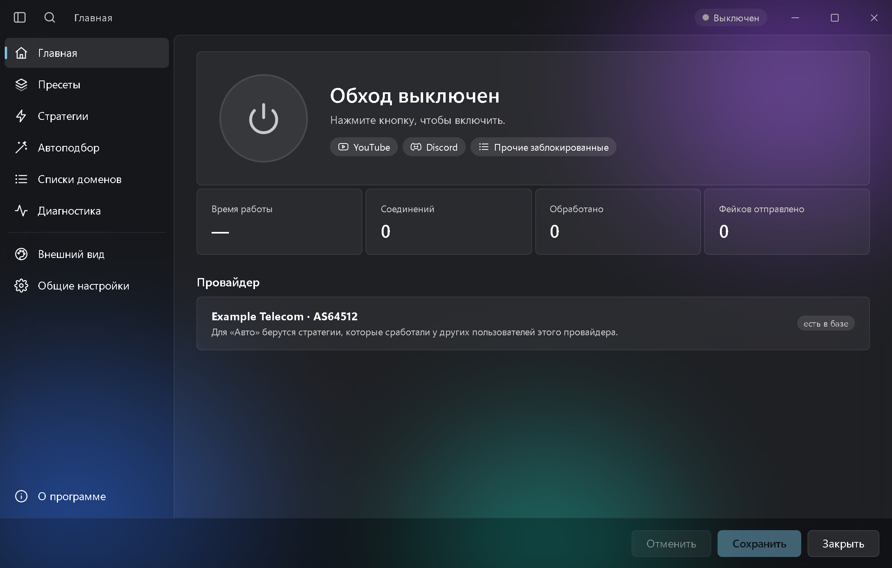
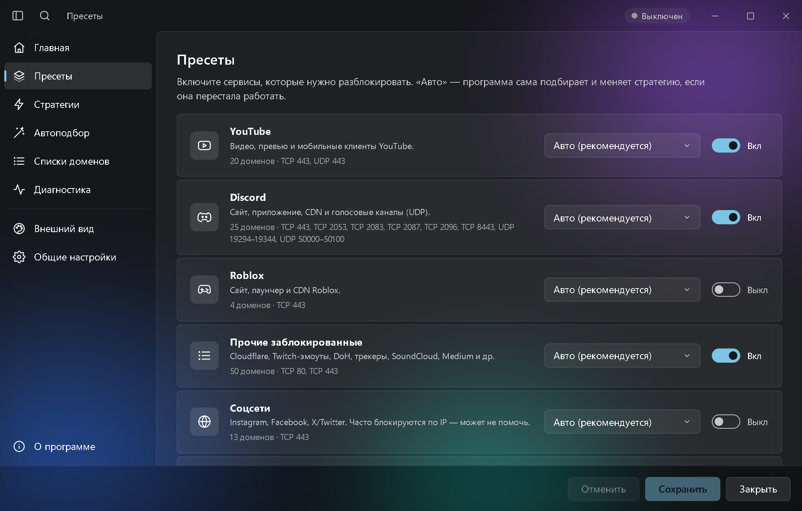
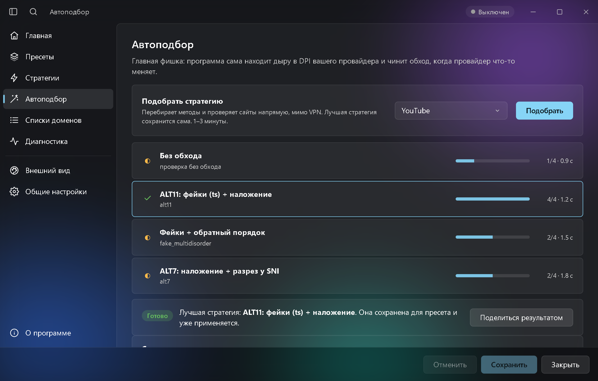
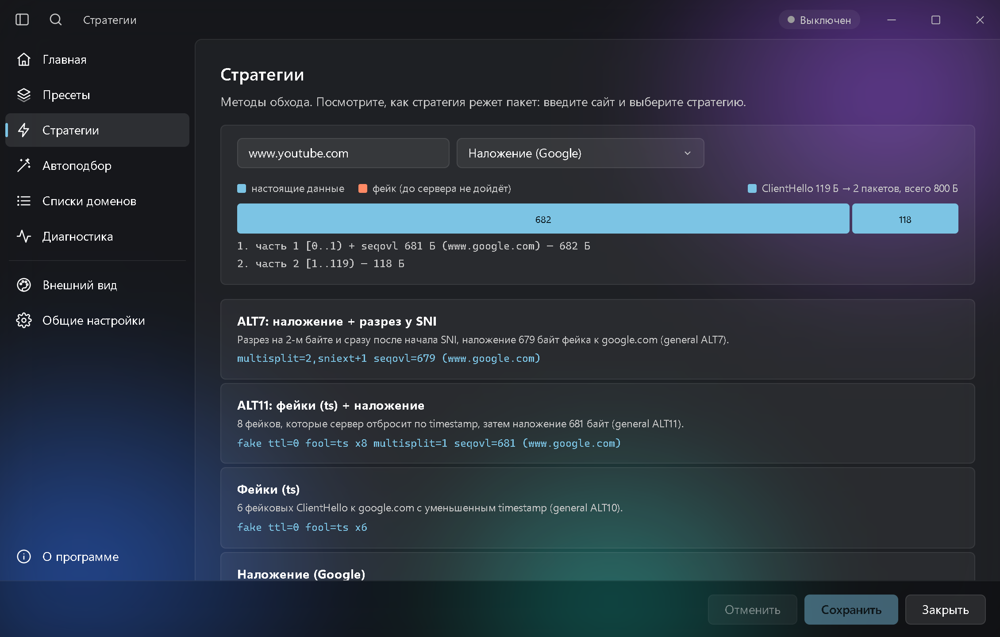
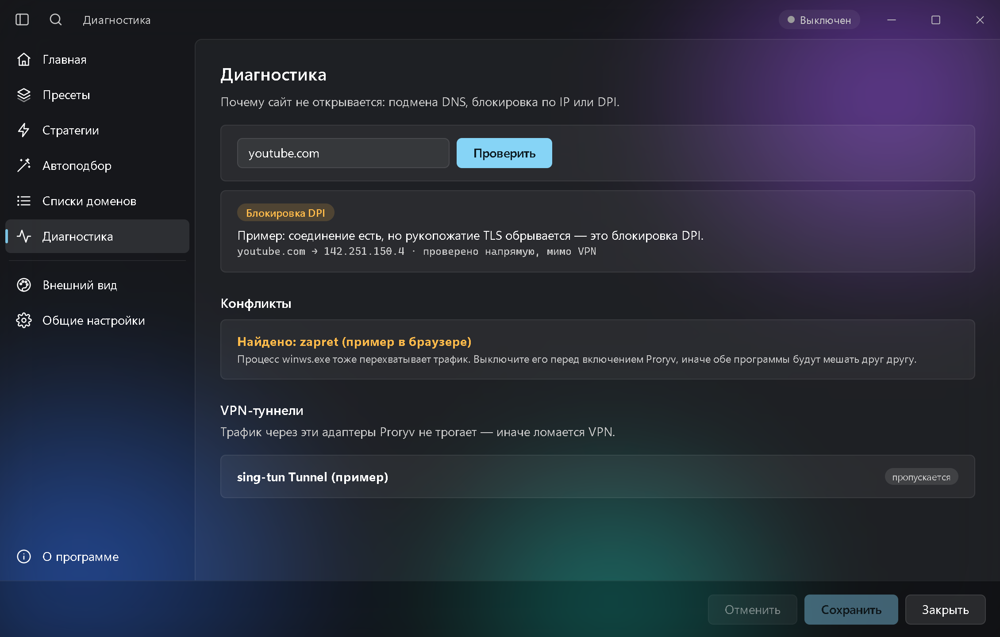
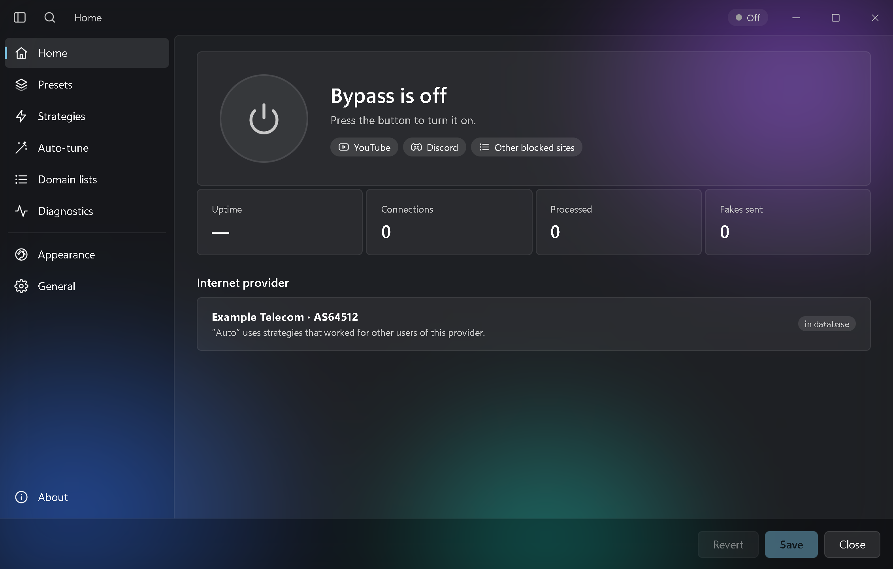
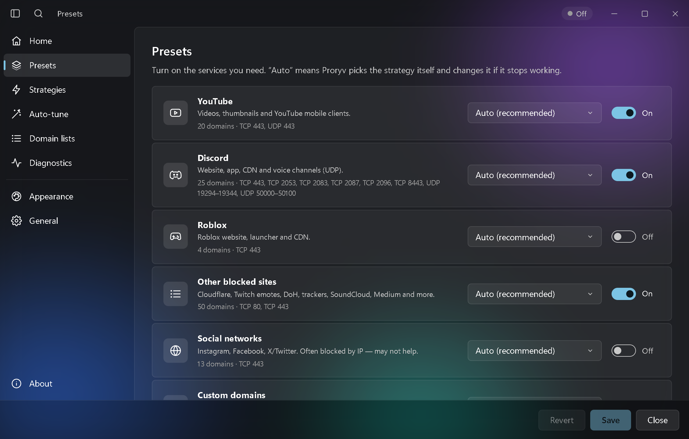
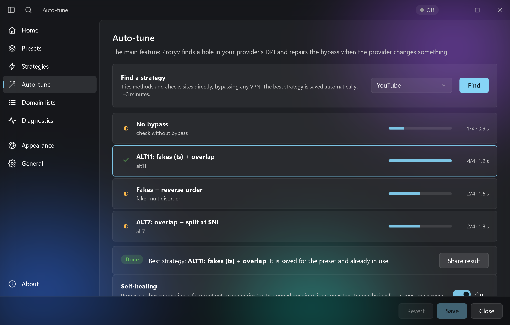

# Proryv

**Обход блокировок YouTube, Discord (с голосом) и Telegram — без VPN, с нормальным интерфейсом.**
Proryv сам подбирает способ обхода под вашего провайдера и чинит его, когда провайдер что-то меняет.

[**⬇ Скачать для Windows**](https://github.com/studiomurda09-dotcom/proryv/releases/latest) · [**💬 Discord-сервер**](https://discord.gg/SzRm7GNyU9) · [English](#english)



## Что умеет

- **Автоподбор.** Перебирает методы обхода и проверяет сайты напрямую, мимо VPN. Для YouTube смотрит не только «открылось», но и скорость видео. Лучший способ сохраняется сам, за 1–3 минуты.
- **Самолечение.** Если сайт перестал открываться или видео тормозит, Proryv перепроверяет и сам переподбирает стратегию — остальные пресеты в это время работают. Зависшее соединение сразу повторяется запасной стратегией. Стратегии запоминаются для каждой сети: сменили Wi-Fi на мобильный — включится та, что там работала.
- **SoundCloud.** Отдельный пресет: сайт, обложки и сам аудиопоток.
- **База провайдеров.** Proryv определяет провайдера и сразу берёт стратегию, которая сработала у других его абонентов.
- **Discord с голосом.** Голосовые каналы работают через тот же пресет, отдельно настраивать не нужно.
- **Telegram.** Встроенный прокси через WebSocket веб-версии Telegram. Подключается одной кнопкой.
- **Game Filter.** Обход для игр (Roblox и др.) в режимах TCP, UDP или оба, как в zapret.
- **Не ломает VPN.** Трафик VPN-туннелей Proryv не трогает. Банки, Госуслуги и игры с античитом исключены.
- **Обновляется сам.** Новые версии ставятся из программы в один клик. Списки сайтов и стратегии подтягиваются с GitHub без новой версии.
- **Поиск по настройкам** (Ctrl+F), русский и английский интерфейс, фон Mica/Acrylic, трей, автозапуск.

| Пресеты | Автоподбор |
|---|---|
|  |  |
| **Стратегии: как режется пакет** | **Диагностика: почему не открывается** |
|  |  |

## Установка

1. Скачайте [последний релиз](https://github.com/studiomurda09-dotcom/proryv/releases/latest): `Proryv_…_x64-setup.exe` или `.msi`.
2. Если Защитник Windows ругается, это из-за драйвера перехвата пакетов WinDivert (на zapret и GoodbyeDPI он ругается так же). Нажмите «Подробнее» → «Выполнить в любом случае».
3. Программа просит права администратора: без них перехватывать трафик нельзя.
4. Пройдите мастер, затем «Автоподбор» → «Подобрать» и большая кнопка на главной.

Не запускайте одновременно zapret, GoodbyeDPI или другой обход: они будут мешать друг другу.

Что-то не открывается? Напишите в [Discord](https://discord.gg/SzRm7GNyU9): название провайдера и какой сайт не работает — подскажем стратегию.

**Telegram:** «Пресеты» → «Дополнительно» → Telegram → включить → «Сохранить» → «Подключить Telegram». Без VPN работают аккаунты на дата-центрах DC2/DC4 (большинство в России). DC1/3/5 заблокированы по IP, и DPI-обход тут бессилен.

## Поделиться стратегией

Подбор нашёл рабочую стратегию? Нажмите **«Поделиться результатом»**. Откроется готовое сообщение в Issues с названием провайдера и результатами. Из таких сообщений пополняется [база провайдеров](data/base.json), и у следующих абонентов вашего провайдера всё заработает сразу.

## Как это работает

Proryv перехватывает первые пакеты соединения через [WinDivert](https://github.com/basil00/WinDivert) и меняет их так, чтобы DPI провайдера не распознал заблокированный сайт, а сервер получил всё как надо:
- режет TLS ClientHello на части;
- меняет порядок частей;
- отправляет фейки, которые сервер отбросит (по TTL, timestamp или неверному seq);
- накладывает данные (seqovl).

Методы те же, что в zapret, переписанные на Rust. Ничего не шифруется и никуда не пересылается: трафик идёт напрямую, поэтому скорость не падает.

## Для разработчиков

```
crates/proryv-core/   ядро: разбор пакетов, стратегии, движок, автоподбор, база
crates/proryv-tg/     прокси Telegram (MTProto → WebSocket)
src-tauri/            окно Tauri 2, трей, команды для интерфейса
ui/                   интерфейс (HTML/CSS/JS без сборщика), i18n.js — английский
data/base.json        обновляемая база: домены, стратегии, провайдеры
promo/                промо-ролик
```

| Что | Команда |
|---|---|
| Тесты ядра | `cargo test -p proryv-core` |
| Запустить приложение | `npx tauri dev` |
| Собрать установщик | `npx tauri build` |
| Интерфейс в браузере | `npm run ui` → http://127.0.0.1:5173 |
| Скриншоты для README | `node tools/shots.mjs` |

Релиз: поднять версию в `src-tauri/tauri.conf.json`, `Cargo.toml` и `package.json`, затем запушить тег `vX.Y.Z`. GitHub Actions скачает официальный WinDivert 2.2.2 и сверит его хеш, соберёт и подпишет установщики и создаст черновик релиза с `latest.json` для автообновления.

---

## English

**Bypass blocks on YouTube, Discord (with voice) and Telegram — no VPN, with a proper UI.**
Proryv finds a DPI bypass strategy for your internet provider by itself and repairs it when the provider changes something.



- **Auto-tune:** tries bypass methods and checks sites directly (bypassing any VPN). The best one is saved automatically.
- **Self-healing:** notices when a site stops opening or video gets slow, rechecks and re-tunes the strategy while other presets keep working. Stuck connections are retried with a fallback strategy at once; strategies are remembered per network.
- **SoundCloud** preset, including the audio stream.
- **Provider database:** detects your provider and uses the strategy that worked for other users of the same provider.
- **Discord voice, Telegram proxy, Game Filter** (TCP/UDP), VPN-safe, one-click updates, settings search, Russian and English UI.

**Install:** download the [latest release](https://github.com/studiomurda09-dotcom/proryv/releases/latest), run the installer and allow administrator rights. If Windows Defender warns about the WinDivert packet driver, choose “More info” → “Run anyway”. Then go to Auto-tune → Find and press the big button on Home. Questions: [Discord](https://discord.gg/SzRm7GNyU9).

| Presets | Auto-tune |
|---|---|
|  |  |

## Лицензия / License

© 2026 studiomurda09-dotcom. Proryv распространяется под лицензией [GNU GPL v3](LICENSE): код можно смотреть, менять и распространять, но любая программа на его основе тоже должна быть открыта под GPL-3.0 с указанием автора.

Сторонние компоненты: WinDivert (LGPL-3.0, драйвер перехвата пакетов), библиотеки Rust под своими лицензиями (MIT / Apache-2.0). Идея Telegram-прокси взята из tg-ws-proxy, методы обхода — из zapret.
